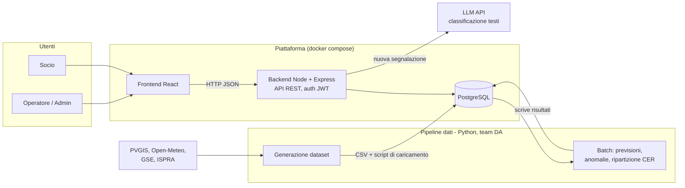
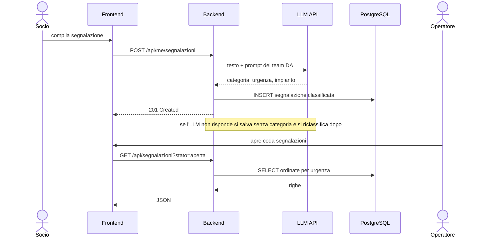

# UnderTheSun — architettura (bozza)

Bozza da validare con il team dati prima del SAL 1 (20 nov). Modello di calcolo: CER realistico (vedi [team-dati.md](team-dati.md)). Contratto API: [api.md](api.md).

I diagrammi sono in Mermaid (GitHub li disegna). Versioni PNG in [img/](img/).

## 1. Architettura della piattaforma

Chi fa cosa:
- **Team DA**: tutto il riquadro "Pipeline dati" + prompt/categorie per l'LLM.
- **WSA**: riquadro "Piattaforma" (DB fisico, API, auth, frontend, docker).
- **Contratto** (congelato al SAL 1): schema tabelle + data dictionary + endpoint API con esempi JSON.

## 2. Modello dati (bozza)

Una sola CER. Le serie orarie hanno chiave composta (id + ts).
Le tabelle marcate *derivata* le riempie il batch Python, non l'utente.

```mermaid
erDiagram
  UTENTE {
    int id PK
    string email
    string password_hash
    string ruolo "socio, operatore, admin"
    int socio_id FK "null per i dipendenti"
  }
  SOCIO {
    int id PK
    string nome
    string tipo "famiglia, impresa, ente"
    string comune
    date data_adesione
  }
  IMPIANTO {
    int id PK
    string nome
    string comune
    float lat
    float lon
    float kwp
    date data_attivazione
  }
  PRODUZIONE_ORARIA {
    int impianto_id FK
    timestamp ts
    float kwh
  }
  METEO_ORARIO {
    int impianto_id FK
    timestamp ts
    float irraggiamento
    float temperatura
    float nuvolosita
  }
  CONSUMO_ORARIO {
    int socio_id FK
    timestamp ts
    float kwh
  }
  BOLLETTA {
    int id PK
    int socio_id FK
    date mese
    float kwh
    float importo_eur
  }
  PREVISIONE_PRODUZIONE {
    int impianto_id FK
    timestamp ts
    float kwh_previsti "derivata"
  }
  PREVISIONE_CONSUMO {
    int socio_id FK
    timestamp ts
    float kwh_previsti "derivata"
  }
  ANOMALIA {
    int id PK
    int impianto_id FK
    timestamp inizio
    timestamp fine "null se ancora in corso"
    string tipo "opzionale: guasto, sporcizia, stringa, neve"
    float score "derivata"
    string stato "aperta, chiusa (la chiude l'operatore)"
  }
  RIPARTIZIONE_MENSILE {
    int socio_id FK
    date mese
    float kwh_condivisi "derivata"
    float incentivo_eur "derivata"
    float co2_evitata_kg "derivata"
  }
  SEGNALAZIONE {
    int id PK
    int socio_id FK
    int impianto_id FK "opzionale"
    timestamp ts
    string canale "email, portale; interno da decidere"
    string testo
    string categoria_llm "da LLM, mai modificata"
    string urgenza_llm "da LLM, mai modificata"
    string categoria "valore in uso, corretto dall'operatore"
    string urgenza "valore in uso, corretto dall'operatore"
    string stato "aperta, in_corso, chiusa"
  }
  VERBALE {
    int id PK
    date data_assemblea
    string testo
    string sintesi "da LLM"
  }
  PARAMETRO {
    string chiave PK "es. fattore_co2, tariffa_gse"
    float valore
    string fonte
  }

  SOCIO |o--o| UTENTE : "account"
  SOCIO ||--o{ CONSUMO_ORARIO : "consuma"
  SOCIO ||--o{ BOLLETTA : "riceve"
  SOCIO ||--o{ RIPARTIZIONE_MENSILE : "incassa"
  SOCIO |o--o{ SEGNALAZIONE : "invia"
  IMPIANTO ||--o{ PRODUZIONE_ORARIA : "produce"
  IMPIANTO ||--o{ METEO_ORARIO : "ha"
  IMPIANTO ||--o{ PREVISIONE_PRODUZIONE : "ha"
  SOCIO ||--o{ PREVISIONE_CONSUMO : "ha"
  IMPIANTO ||--o{ ANOMALIA : "ha"
  IMPIANTO |o--o{ SEGNALAZIONE : "riguarda"
```

Note sul modello:
- **Segnalazioni**: l'LLM scrive sia `categoria_llm`/`urgenza_llm` sia `categoria`/`urgenza`. L'operatore corregge solo le seconde: il confronto tra le due coppie misura l'accuratezza dell'LLM.
- **Anomalie**: il batch le crea con `stato = aperta`; il `tipo` lo riempie il modello solo se sa riconoscerlo, altrimenti resta vuoto. Le "anomalie aperte" dell'API sono quelle con `stato = aperta`. Sulla tabella scrivono in due, batch e operatore: il batch **aggiunge** le anomalie nuove e non cancella né riscrive quelle esistenti, altrimenti riaprirebbe quelle già chiuse dall'operatore.
- **Previsioni**: `previsione_produzione` si vede nella pagina Impianti (operatore), `previsione_consumo` nella dashboard del socio.

Domande aperte per il team DA:
- Serve la cabina primaria (in una CER reale la condivisione vale per cabina)? Proposta: tutti sotto la stessa, campo aggiunto solo se serve.
- La tariffa GSE dipende dal prezzo zonale: serve una tabella `prezzo_orario` o basta un valore medio in `PARAMETRO`?
- Le "comunicazioni guasti" sono segnalazioni con `canale = interno` o una tabella a parte?

## 3. Flusso di una segnalazione

## 4. Pagine (prima stesura)

| Ruolo | Pagina | Dati |
|---|---|---|
| Socio | Simulatore di risparmio | consumi orari del socio + formula CER |
| Socio | Dashboard personale | consumi reali e previsti, kWh condivisi, incentivo, CO2 evitata |
| Socio | Le mie segnalazioni | apri nuova, vedi stato |
| Operatore | Impianti | produzione vs previsione, anomalie |
| Operatore | Coda segnalazioni | classificate e ordinate per urgenza |
| Admin | KPI comunità | energia condivisa, incentivi totali, CO2, soci |
| Admin | Assemblee | verbali + sintesi |
