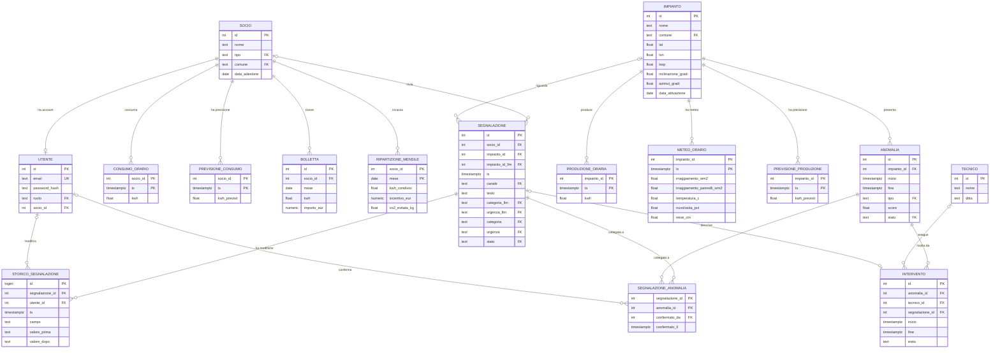
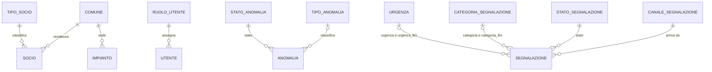

# UnderTheSun — design relazionale del database

> **Stato: proposta del 23 novembre 2026**, da discutere con Francesco e Luca.
> La migrazione **non è ancora stata eseguita su PostgreSQL**: è stata controllata solo offline sul campione SAL 1 (sezione 9).

## 1. In breve

Il database resta **un solo PostgreSQL, interamente relazionale**. Le 14 tabelle congelate al SAL 1 non cambiano: niente colonne nuove, tolte o rinominate. Una nuova migrazione aggiunge:

- **9 tabelle di riferimento**: comuni, tipi, ruoli, canali, categorie, urgenze e stati;
- **4 tabelle di relazione e storico**: collegamento segnalazione-anomalia, storico delle correzioni, tecnici e interventi;
- **12 chiavi esterne** sulle colonne esistenti;
- **3 regole nuove**, 4 trigger, 1 vista e 14 indici, compresa la ricerca nei testi.

| File | Contenuto |
|---|---|
| `db/migrations/20261124090000_design_relazionale.sql` | La migrazione, con `up` e `down` |
| `db/prove/prova_design_relazionale.sql` | Prove dei vincoli, in una transazione annullata |
| `db/prove/verifica_riferimenti.py` | Controllo offline su schema e CSV |

## 2. Requisiti

**Funzionali**, dal documento del laboratorio e dal piano di progetto:

- il socio vede solo i propri consumi, incentivi, CO₂ e segnalazioni;
- l'operatore gestisce impianti, anomalie e coda delle segnalazioni, e può correggere l'LLM;
- l'admin vede KPI, soci e verbali;
- i dati non strutturati (email, comunicazioni, verbali) stanno con quelli strutturati e si possono cercare;
- i batch scrivono previsioni, anomalie e ripartizione senza riaprire ciò che l'operatore ha chiuso.

**Volumi del dataset completo** (8 impianti, 240 soci, 17.520 ore):

| Tabelle | Righe |
|---|---:|
| `consumo_orario` + `previsione_consumo` | 8.409.600 |
| `produzione_oraria` + `meteo_orario` + `previsione_produzione` | 420.480 |
| `bolletta` + `ripartizione_mensile` | 11.520 |
| Segnalazioni e verbali | circa 290 |
| **Totale** | **circa 8,84 milioni** |

**Vincoli:** schema congelato, CSV caricati con `HEADER match`, team di 7 persone, consegna il 21 dicembre.

## 3. Come resta compatibile

- `\copy ... HEADER match` richiede che le intestazioni coincidano con **tutte** le colonne, quindi non si può aggiungere nessuna colonna alle tabelle caricate dai CSV.
- Per questo le tabelle di riferimento hanno **chiavi naturali di testo**. `socio.comune` resta `'Pinerolo'` e diventa chiave esterna verso `comune.nome`. Forma dei CSV e delle risposte API non cambia.
- I valori di riferimento sono inseriti **dentro la migrazione**, perché `migrate` gira prima di `seed`.
- I `CHECK` della prima migrazione restano. La regola è scritta due volte, ma lo schema congelato non si tocca.

**Tre regole cambiano il comportamento e vanno approvate dal team**, perché rifiutano scritture che oggi passano:

1. una segnalazione non interna senza socio, o una interna con socio (`ck_segnalazione_interno`);
2. una seconda anomalia con stesso impianto e stesso `inizio` (`uq_anomalia_impianto_inizio`);
3. la riscrittura di una colonna `*_llm` già valorizzata (trigger `tr_segnalazione_blocca_llm`).

## 4. Diagramma entità-relazioni

Le 9 tabelle di riferimento sono nel secondo diagramma, per leggibilità.



`verbale` e `parametro` sono tabelle indipendenti, senza relazioni.



## 5. Nuove tabelle

**Tabelle di riferimento**

| Tabella | Chiave | Valori |
|---|---|---|
| `comune` | `nome` | Gli 8 comuni della guida |
| `tipo_socio` | `codice` | famiglia, impresa, ente |
| `ruolo_utente` | `codice` | socio, operatore, admin |
| `canale_segnalazione` | `codice` | email, portale, interno |
| `categoria_segnalazione` | `codice` | Le 6 categorie del data dictionary |
| `urgenza` | `codice` | alta, media, bassa, con `ordine` 1, 2, 3 |
| `stato_segnalazione` | `codice` | aperta, in_corso, chiusa |
| `stato_anomalia` | `codice` | aperta, chiusa |
| `tipo_anomalia` | `codice` | guasto, sporcizia, stringa, neve |

La coda deve ordinare con `JOIN urgenza ... ORDER BY urgenza.ordine, ts`: ordinate come testo, le urgenze darebbero alta, bassa, media.

**Relazioni e storico**

| Tabella | A cosa serve | Chi la scrive |
|---|---|---|
| `segnalazione_anomalia` | Collegamento N:M **confermato** tra segnalazioni e anomalie (US-15) | Operatore, con un endpoint da aggiungere |
| `storico_segnalazione` | Una riga per ogni cambio di stato, categoria, urgenza o impianto | Trigger automatico |
| `tecnico` | Nome e ditta, senza ripeterli a ogni intervento | Operatore o batch di estrazione |
| `intervento` | Anomalia, tecnico, date, esito. Il testo resta nella segnalazione `interno` | Operatore o batch di estrazione |

- **Le comunicazioni sui guasti restano segnalazioni con `canale = 'interno'`**, come deciso nella guida. `intervento` aggiunge solo i dati strutturati estratti da quel testo.
- `tecnico` e `intervento` **restano vuote** finché qualcuno non le usa. Se il team non le vuole, si tolgono senza effetti sul resto.
- Per sapere **chi** ha fatto una modifica, il backend deve eseguire nella stessa transazione `SELECT set_config('app.utente_id', '<id>', true)`. Senza, lo storico funziona ma `utente_id` resta vuoto.
- Lo storico registra anche la classificazione arrivata in ritardo, quando l'LLM era offline. Le **correzioni dell'operatore** sono le righe su `categoria` o `urgenza` con `valore_prima` non vuoto.

**Vista `v_segnalazione_anomalia_candidata`:** propone le coppie con lo stesso impianto, dal giorno prima dell'anomalia a tre giorni dopo la fine. Dice anche se la coppia è già stata confermata.

**Regole nuove**

| Regola | Perché |
|---|---|
| `canale = 'interno'` se e solo se `socio_id` è vuoto | Coerenza delle comunicazioni interne |
| `UNIQUE (impianto_id, inizio)` su `anomalia` | Un batch rilanciato con `ON CONFLICT DO NOTHING` non duplica né riapre la stessa anomalia. **Limite:** se un modello migliorato sposta `inizio` anche di un'ora, crea una riga nuova, quindi il batch deve comunque saltare i periodi già coperti da anomalie esistenti |
| Email unica senza distinguere le maiuscole | Il login confronta `lower(email)` |
| Colonne `*_llm`: da vuote a piene, poi fisse | Servono a misurare l'accuratezza dell'LLM |
| Si collegano solo segnalazioni e anomalie dello stesso impianto | Evita collegamenti sbagliati |
| Un intervento può citare solo una comunicazione interna | Coerenza con la scelta del team |

**Indici**

| Indice | Serve a |
|---|---|
| `consumo_orario(ts)`, `produzione_oraria(ts)` | Totali della comunità per ora (`/api/comunita/energia`) |
| `ripartizione_mensile(mese)` | KPI mensili |
| `segnalazione(stato, urgenza, ts)` | Coda dell'operatore |
| `segnalazione(socio_id, ts DESC)` | "Le mie segnalazioni" |
| `segnalazione(impianto_id, ts)` | Segnalazioni vicino a un'anomalia |
| `anomalia(impianto_id) WHERE stato = 'aperta'` | Contatore delle anomalie aperte |
| GIN su `segnalazione.testo` e `verbale.testo` | Ricerca nei testi in italiano |

## 6. Normalizzazione

| Forma | Come è rispettata |
|---|---|
| **1NF** | Valori atomici, nessuna lista in una colonna, ogni tabella ha una chiave primaria |
| **2NF** | Nelle serie con chiave `(id, ts)` i valori dipendono dalla chiave intera; i dati anagrafici stanno in `socio` e `impianto` |
| **3NF** | Descrizioni e ordini stanno nelle tabelle di riferimento; la ditta dipende dal tecnico e sta in `tecnico`; l'impianto di un intervento si ricava dall'anomalia |

**Scostamenti voluti**

| Caso | Perché resta così |
|---|---|
| `previsione_*`, `anomalia.score`, `ripartizione_mensile` | Risultati dei batch, salvati per non fare calcoli pesanti a ogni clic |
| `bolletta.kwh`, `bolletta.importo_eur` | Sono la fotografia di un documento emesso: non devono cambiare se cambiano prezzi o consumi |
| `segnalazione.categoria` e `categoria_llm` | Non sono un doppione: una è il valore in uso, l'altra la risposta originale |
| `parametro` chiave-valore | Poche costanti con la loro fonte, lette dai batch. Non partecipano a relazioni |
| `CHECK` e chiavi esterne sulla stessa colonna | Per non modificare la migrazione congelata. Aggiungere un valore richiede di aggiornare entrambi |
| Serie orarie senza tabella `calendario` | Le date si calcolano da `ts`; una tabella aggiungerebbe un join su milioni di righe |

## 7. Scelte e alternative

| Scelta | Vantaggio | Costo | Alternativa scartata |
|---|---|---|---|
| Estensione invece di redesign | Backend, API e CSV restano validi | Restano i `CHECK` doppi | Riscrivere lo schema dopo il congelamento |
| Chiavi naturali di testo | Nessuna colonna nuova | Indici un po' più grandi | ID numerici, che romperebbero `HEADER match` |
| Un solo database | Join, vincoli e transazioni su tutti i dati | Nessuno ai volumi attuali | Database separato per i testi |
| Storico con trigger | Funziona anche senza modifiche al backend | L'utente va passato a parte | Scrittura manuale nel backend |
| Link confermato + vista | Distingue proposta del sistema e conferma umana | Serve un endpoint | Solo vista, senza conferma |

## 8. Cosa serve agli altri

- **Luca:** valutare la migrazione. Eseguire le prove della sezione 9.
- **Stefano:** usare `urgenza.ordine` nella coda, impostare `app.utente_id` nei `PATCH`, aggiungere l'endpoint di conferma del collegamento.
- **Francesco / batch anomalie:** inserire con `ON CONFLICT (impianto_id, inizio) DO NOTHING` (un `INSERT` semplice ora si ferma sui doppioni) e saltare i periodi già coperti da un'anomalia dello stesso impianto.
- **Batch di classificazione:** scrivere le colonne `*_llm` solo dove sono vuote. Per confrontare prompt diversi, salvare i risultati in un file: riscriverle nel database ora dà errore.
- **Da decidere:** la CO₂ della comunità si calcola sulla produzione, quella dei soci sull'energia condivisa, quindi la somma per socio non coincide con il totale chiesto da US-09. Lo schema regge entrambe le scelte.

## 9. Verifica

**Già fatto, offline, sul campione SAL 1 di Francesco** (13 CSV, con 20 soci, 3 impianti, 15 segnalazioni e 1 anomalia):

- nessuna colonna delle 14 tabelle è cambiata;
- le chiavi esterne usano tabelle e colonne esistenti;
- il `down` elimina tutto ciò che crea l'`up`;
- ogni valore di comuni, tipi, categorie, urgenze e stati è presente nelle tabelle di riferimento;
- le nuove regole su comunicazioni interne e anomalie doppie sono rispettate.

Il controllo **non** verifica la sintassi SQL né il funzionamento dei trigger. Va rilanciato sul dataset completo al SAL 2, indicando `data/output` come ultimo argomento:

```bash
python db/prove/verifica_riferimenti.py db/migrations/20261116090000_schema_iniziale.sql db/migrations/20261124090000_design_relazionale.sql data/esempi
```

**Ancora da fare, serve Docker.** Da Git Bash, su questo branch:

```bash
docker compose down -v
docker compose up -d db migrate
docker compose run --rm seed
docker compose exec -T db sh -c 'psql -U "$POSTGRES_USER" -d "$POSTGRES_DB"' < db/prove/prova_design_relazionale.sql
docker compose run --rm migrate --no-dump-schema rollback
docker compose run --rm migrate
```

Esito atteso: l'ultima riga delle prove è `TUTTE LE PROVE SONO PASSATE`, poi il rollback e la nuova applicazione terminano senza errori. Attenzione: `docker compose down -v` **cancella il database locale**.

## 10. Cosa rivedere se il sistema cresce

- **Più di qualche anno di dati:** partizionare `consumo_orario` e le previsioni per mese.
- **Più comunità:** aggiungere `comunita` e `cabina_primaria`, oggi unica per scelta.
- **Più versioni dei modelli:** aggiungere una tabella `esecuzione_modello`.
- **Dati veri:** registro degli accessi e tempi di conservazione per GDPR.
- **Dopo il progetto:** togliere i `CHECK` doppi con una migrazione dedicata.
