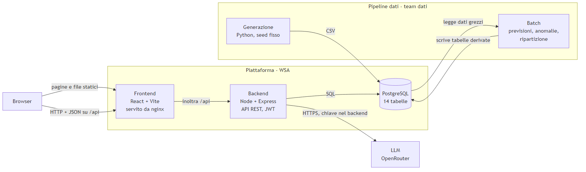
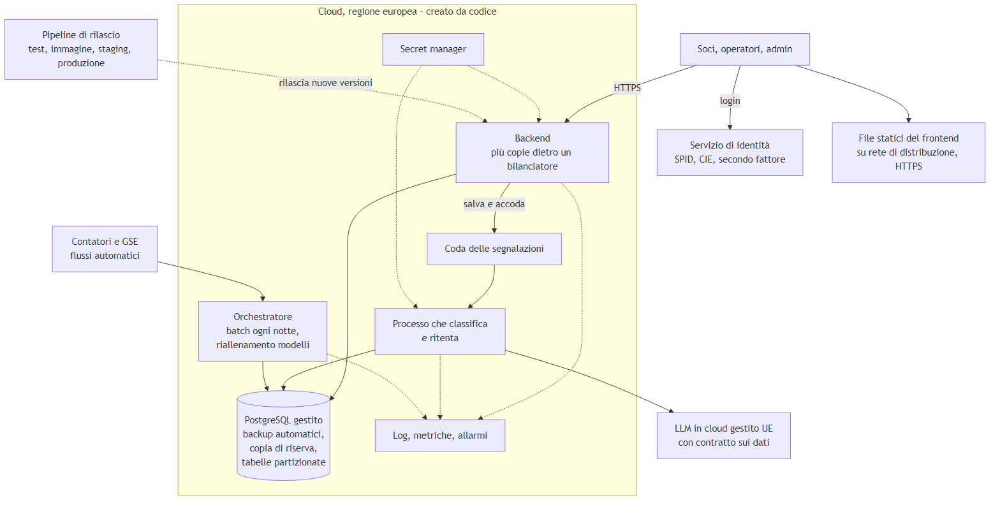

# UnderTheSun — piano di progetto

> **v0.1 — bozza da discutere** · 12 nov 2026 · team PlusUltra
> Cosa costruiamo, come è fatto, chi fa cosa e quando. Tutto è una proposta: ditemi cosa non va.

## 1. Come leggerlo e come rispondere

Dieci pagine circa. Se avete poco tempo, leggete almeno le sezioni **4 (storie)**, **8 (ruoli)** e **9 (roadmap)**.

- **Entro martedì 17 novembre** scrivete sul gruppo WhatsApp cosa cambiereste, cosa manca, cosa non è chiaro. Anche un "per me va bene" è utile.
- Venerdì **20 novembre** (SAL 1, in aula) confermiamo insieme la versione 1.0.
- Se non siamo d'accordo su qualcosa ne parliamo; se non si trova una sintesi, decide il team leader.

Il dettaglio tecnico è nei documenti del repo `under-the-sun`: `docs/architettura.md` (modello dati), `docs/api.md` (contratto API), `docs/team-dati.md` (brief per il team dati), `docs/git.md` (guida Git).

## 2. Il prodotto in una pagina

**Buby Green** gestisce impianti fotovoltaici condivisi e distribuisce l'energia ai soci: famiglie, imprese, enti. In pratica è una **Comunità Energetica Rinnovabile (CER)**: gli impianti immettono energia in rete, i soci la prelevano, e per ogni ora l'energia "condivisa" vale `min(immessa, prelevata)`. Su quella il GSE paga un incentivo, che la comunità ripartisce tra i soci.

Il problema del cliente: produzione e consumi non sono monitorati in modo integrato, l'impatto ambientale non è misurato e le segnalazioni dei soci non vengono analizzate.

**UnderTheSun** è il portale della comunità:

- il **socio** vede i suoi consumi, quanto ha preso di incentivo, la CO2 evitata, prova un simulatore di risparmio e invia segnalazioni;
- l'**operatore** controlla gli impianti, le previsioni, le anomalie e la coda delle segnalazioni, già classificate da un LLM;
- l'**admin** vede gli indicatori della comunità e le sintesi delle assemblee.

I dati non ce li dà il cliente: **li generiamo noi**, partendo da fonti reali (PVGIS, Open-Meteo, ARERA, ISPRA, GSE, GME). Una comunità, 5–10 impianti, 100–300 soci, 2 anni di dati orari.

## 3. Chi usa il sistema

| Personaggio | Chi è | Cosa vuole |
|---|---|---|
| **Socio famiglia** | Maria, 42 anni, due figli, non è un'esperta | Capire se le conviene, senza leggere tabelle |
| **Socio impresa** | Gianni, ha un forno di quartiere | Spostare i consumi nelle ore di sole e risparmiare |
| **Socio ente** | La scuola media del paese | Segnalare problemi e avere risposte |
| **Operatore** | Sara, tecnica di Buby Green | Sapere subito quale impianto ha un problema e perché |
| **Admin** | Il responsabile della comunità | I numeri per l'assemblea e per il cliente |
| **Team dati** | Noi data analyst | Caricare i dati e far girare i modelli senza rompere niente |

Regola di privacy: il socio vede **solo i propri dati**; l'operatore vede gli impianti e i consumi **solo aggregati**; l'admin vede tutto.

## 4. Cinque storie

Sono anche il **copione della demo** del 21 dicembre: se queste cinque storie funzionano dal vivo, il progetto è riuscito.

**Maria a fine mese.** Maria entra nel portale dal telefono. In alto vede tre numeri: i kWh che ha consumato a ottobre, i 6,40 € di incentivo che le spettano e i 18 kg di CO2 evitata. Sotto, un grafico mette a confronto i suoi consumi con la previsione: a metà mese c'è un picco, e lei si ricorda della lavatrice rotta che girava a vuoto.

**Il forno di Gianni.** Gianni inforna alle 5 di mattina, quando i pannelli non producono. Apre il simulatore, sposta due ore di forno elettrico alle 12 e vede la stima: +30 % di energia condivisa, circa 15 € in più all'anno di incentivo. Decide di provarci per le infornate del pomeriggio.

**La scuola segnala un guasto.** Il bidello nota che il display dell'inverter sul tetto è spento e scrive: "Da ieri il coso dei pannelli non si accende più". Il portale salva la segnalazione e l'LLM la classifica come *guasto impianto*, urgenza *alta*, impianto *Scuola media*. La scuola vede la segnalazione "aperta".

**Sara collega i puntini.** La mattina Sara apre la pagina impianti: l'impianto della scuola produce il 60 % in meno di quanto previsto da due giorni, ed è segnato come **anomalia aperta**. In cima alla coda trova la segnalazione della scuola e altre due di soci vicini. Manda il tecnico, poi chiude l'anomalia e le segnalazioni. Una categoria sbagliata dall'LLM la corregge a mano: la correzione resta registrata e serve a misurare quanto l'LLM sbaglia.

**L'assemblea.** Prima dell'assemblea annuale l'admin apre la pagina della comunità: energia condivisa nell'anno, incentivi totali, CO2 evitata, numero di soci. Accanto c'è la sintesi automatica del verbale dell'ultima assemblea, così non deve rileggerlo tutto.

**Dietro le quinte (team dati).** Francesco migliora il modello delle anomalie e rilancia il batch. Nel database arrivano le nuove previsioni e le nuove anomalie; quelle che Sara aveva già chiuso **restano chiuse**.

## 5. User story

Forma: *come [chi] voglio [cosa] per [perché]*. Priorità: **I** = indispensabile per la demo, **U** = utile, **E** = extra se avanza tempo. "Fatto quando" è il criterio per dire che la storia è finita.

| ID | Come… voglio… | Fatto quando | Pr. | Sprint | Chi |
|---|---|---|---|---|---|
| US‑01 | socio, entrare con email e password e vedere **solo i miei** dati | un socio che chiede i dati di un altro riceve 403 | I | 1 | Stefano, Mirko |
| US‑02 | socio, vedere i miei consumi reali e previsti per giorno e per mese | grafico con dati presi dal DB, non scritti nel codice | I | 1 | Mirko, Stefano |
| US‑03 | socio, vedere kWh condivisi, incentivo e CO2 evitata del mese | i numeri coincidono con la tabella di ripartizione | I | 2 | Mirko, team dati |
| US‑04 | socio, simulare quanto risparmio spostando i consumi | cambio un input e la stima si aggiorna | I | 2 | Stefano, Mirko |
| US‑05 | socio, inviare una segnalazione e vederne lo stato | salvata anche se l'LLM non risponde | I | 1–2 | Stefano, Mirko |
| US‑06 | operatore, vedere produzione e previsione di ogni impianto | grafico reale contro previsto | I | 2 | Mirko, Stefano |
| US‑07 | operatore, vedere le anomalie aperte e chiuderle | una volta chiusa resta chiusa dopo il batch | I | 2 | Stefano, Mirko |
| US‑08 | operatore, avere le segnalazioni ordinate per urgenza e correggerne la categoria | si vedono sia la categoria dell'LLM sia quella corretta | I | 2 | Stefano, Mirko |
| US‑09 | admin, vedere gli indicatori della comunità | i totali coincidono con la somma per socio | I | 2 | Mirko, Stefano |
| US‑10 | team dati, caricare i CSV nel DB con un comando | DB vuoto → dati caricati senza errori | I | 0 | Luca |
| US‑11 | team dati, lanciare i batch che scrivono nel DB | previsioni, anomalie e ripartizione visibili nel portale | I | 2 | Francesco + DA, Luca |
| US‑12 | team dati, misurare l'accuratezza della classificazione | un numero ("x % di categorie giuste") nel report | I | 2 | team dati |
| US‑13 | sviluppatore, avviare tutto con un comando | `docker compose up` funziona su ogni PC del team | I | 0 | Luca |
| US‑14 | admin, leggere i verbali con la sintesi dell'LLM | sintesi presente per ogni verbale | U | 2–3 | Stefano, team dati |
| US‑15 | operatore, vedere vicino a un'anomalia le segnalazioni dello stesso impianto | stesso impianto, stessi giorni | U | 2 | Geoffrey |
| US‑16 | socio, vedere lo storico delle bollette | elenco mese per mese | U | 2 | Geoffrey |
| US‑17 | admin, vedere l'elenco dei soci con il dettaglio | filtro per tipo di socio | E | 3 | Geoffrey |

**Fuori dal prototipo**, da citare alla presentazione come sviluppi futuri: iscrizione online di nuovi soci, notifiche via email, app per il telefono, più comunità nello stesso sistema.

## 6. Architettura del prototipo

Tre livelli più una pipeline dati che lavora a lato.

| Pezzo | Tecnologia | Cosa fa | Chi |
|---|---|---|---|
| Frontend | React + Vite, grafici con Recharts | le pagine di socio, operatore e admin | Mirko |
| Backend | Node + Express, login con JWT | API REST, ruoli, simulatore, chiamata all'LLM | Stefano |
| Database | PostgreSQL, schema versionato | l'unico posto dove stanno i dati (14 tabelle) | Luca (struttura), team dati (contenuto) |
| Pipeline dati | Python: pandas, scikit-learn | genera il dataset e, in batch, previsioni, anomalie e ripartizione | team dati |
| LLM | servizio esterno con piano gratuito | classifica le segnalazioni e riassume i verbali | prompt del team dati, chiamata di Stefano |
| Impacchettamento | Docker Compose + GitHub Actions | un comando avvia tutto; controlli automatici a ogni PR | Luca |

Le due regole che reggono tutto:

1. **Il frontend e la pipeline dati non si parlano mai direttamente**: si incontrano nel database. Per questo lo schema delle tabelle e il contratto API, congelati al SAL 1, sono il vero accordo tra i due gruppi.
2. **Niente calcoli pesanti al clic**: previsioni, anomalie e ripartizione sono già calcolate e salvate. Al volo si fanno solo il simulatore e la classificazione di una nuova segnalazione.

**Sull'LLM**: usiamo solo piani gratuiti. Basta che la classificazione esista e funzioni in principio; se il servizio è lento o esaurisce le chiamate, il portale salva comunque la segnalazione, e per sviluppo e demo c'è una versione "finta" che risponde sempre.

## 7. La versione commerciale (teoria)

Il prototipo deve funzionare un pomeriggio, su un PC, con dati finti. Un prodotto vero deve funzionare per anni, con dati personali veri. Non la costruiamo, ma sapere come sarebbe ci serve per rispondere al cliente.

| Tema | Prototipo | Prodotto reale |
|---|---|---|
| Dove gira | un portatile con Docker Compose | cloud in regione europea, più copie del backend |
| Database | un container Postgres | Postgres gestito: backup automatici, copia di riserva |
| Dati | CSV generati da noi | flussi automatici dai contatori, con controlli di qualità |
| Batch e modelli | lanciati a mano, allenati una volta | programmati ogni notte, riallenati e monitorati |
| Login | email e password nostre | SPID/CIE, secondo fattore per operatori e admin |
| Segreti | file `.env` non committato | secret manager con rotazione delle chiavi |
| LLM | piano gratuito, chiamato al momento | modello in UE con contratto sui dati; una coda che ritenta |
| Ambienti e rilascio | PC di ognuno + demo, aggiornamento a mano | sviluppo, collaudo e produzione; rilascio automatico |
| Controllo | guardo i log | log centralizzati, metriche, allarmi |
| Privacy | dati finti, ruoli | valutazione d'impatto, tempi di conservazione, registro degli accessi |

**Cosa non cambierebbe**, ed è la parte da difendere: tre livelli separati, vincoli nel database, schema che cambia solo con migrazioni, calcoli pesanti in batch, chiave dell'LLM solo nel backend, ruoli controllati dal server, branch + Pull Request + controlli automatici, orari in UTC.

## 8. Ruoli

| Persona | Ruolo | Di cosa risponde |
|---|---|---|
| **Luca** | Team leader, DevOps | Docker, database e migrazioni, CI, integrazione, merge su `main`, stato settimanale al cliente, presentazione principale |
| **Stefano** | Backend · vice | API, login e ruoli, simulatore, chiamata all'LLM |
| **Mirko** | Frontend · vice | wireframe, pagine React, grafici, navigazione per ruolo |
| **Geoffrey** | Jolly | dove c'è il collo di bottiglia dello sprint; più due compiti fissi: **ponte Git** per il team dati e **giro di prova** dell'app prima dei merge, copione della demo |
| **Francesco** | Riferimento del team dati | il punto di contatto unico tra team dati e WSA |
| **Francesco, Giuseppe, Cecilia** | Team dati | gli obiettivi della sezione 9; si dividono il lavoro tra loro |

Stefano e Mirko sono i **vice**: in assenza del team leader approvano le PR e prendono le decisioni urgenti.

**Al team dati**: vi diamo obiettivi e scadenze, non compiti singoli. Ditemi entro il 20 novembre come vi dividete (per esempio: dataset, modelli, testi).

**Il team dati e Git**: chi non usa Git lavora in una **cartella condivisa su Drive**; Geoffrey porta i file nel repo con una Pull Request e, a chi vuole imparare, lo fa fare insieme. Il repo resta l'unico posto "ufficiale".

## 9. Roadmap e sprint

Ogni sprint inizia e finisce con un incontro di laboratorio, così si pianifica e si verifica in presenza.

| Incontro | Cosa si fa |
|---|---|
| ven 20 nov · **SAL 1** | chiusura sprint 0; schema e API congelati |
| lun 23 nov | pianificazione sprint 1 |
| ven 27 nov | punto a metà sprint 1 |
| ~mar 1 dic, online | punto flessibile (tra il 27 nov e il 9 dic non ci sono incontri) |
| ven 4 dic · **SAL 2** | chiusura sprint 1 |
| mer 9 dic | punto a metà sprint 2 |
| lun 14 dic | chiusura sprint 2; da qui niente funzioni nuove |
| ven 18 dic | **prova generale** della demo |
| lun 21 dic · **consegna finale** | presentazione al cliente |

### Sprint 0 — Fondamenta (12 → 20 nov)

| Chi | Cosa | Entro |
|---|---|---|
| Luca | inviti GitHub accettati da tutti | lun 16 nov |
| Luca | Docker Compose con Postgres e schema; caricamento dei CSV (US-10, US-13) | mer 18 nov |
| Mirko | wireframe delle pagine | mer 18 nov |
| Stefano | scheletro del backend: login e un endpoint di prova | ven 20 nov |
| Geoffrey | cartella Drive del team dati; CI di base con Luca | ven 20 nov |
| Team dati | fonti scelte, data dictionary, **CSV di esempio di 1 settimana**, risposte alle 6 domande aperte | ven 20 nov |
| Tutti | commenti a questo documento | **mar 17 nov** |

### Sprint 1 — Primo percorso completo (23 nov → 4 dic)

| Chi | Cosa |
|---|---|
| Stefano + Mirko | login, dashboard del socio con dati veri dal DB, invio delle segnalazioni (US-01, 02, 05) |
| Geoffrey | dove serve; giro di prova a ogni PR |
| Luca | CI completa, integrazione, revisione delle PR |
| Team dati | **dataset completo di 2 anni**; 200–300 segnalazioni etichettate; prima versione dei modelli |

### Sprint 2 — Tutto collegato (4 → 14 dic)

| Chi | Cosa |
|---|---|
| Stefano + Mirko | simulatore, pagine dell'operatore e dell'admin (US-03, 04, 06–09) |
| Geoffrey | storie utili (US-15, 16) |
| Luca + Francesco | batch che scrivono nel DB (US-11) |
| Team dati | accuratezza della classificazione (US-12); numeri per la presentazione: CO2, risparmi, accuratezza dei modelli |

### Sprint 3 — Rifinitura e prova (14 → 21 dic)

Solo correzioni. Copione della demo (Geoffrey), slide (Luca, con una parte per ciascun gruppo), prova generale il 18, consegna il 21.

**Comunicazione**: sul gruppo WhatsApp ognuno scrive **lunedì e giovedì** tre righe: fatto, prossimo, bloccato. Da lì il team leader prepara lo stato settimanale per il cliente.

## 10. Regole di lavoro

- **Un solo repo**, `under-the-sun`. Su `main` non si scrive direttamente: si lavora su un branch (`frontend/…`, `backend/…`, `dati/…`, `docs/…`) e si apre una **Pull Request**.
- Ogni PR ha bisogno di **1 approvazione** e dei controlli automatici verdi.
- Nel repo **non vanno** il dataset completo né le chiavi: solo gli script (con seed fisso) e i CSV di esempio.
- Orari sempre in **UTC** nei dati; si convertono solo quando si mostrano.

**"Fatto" vuol dire**: PR approvata, controlli verdi, provato a mano almeno una volta, nessun dato personale vero.

## 11. Rischi e domande aperte

| Rischio | Cosa facciamo |
|---|---|
| Il dataset arriva tardi e blocca le pagine | i WSA sviluppano sui CSV di 1 settimana del 20 nov |
| Dodici giorni senza incontri (27 nov → 9 dic) | punto online flessibile + aggiornamenti su WhatsApp |
| Verifiche in mezzo agli sprint (NoSQL 23 nov, Python 30 nov) | lo sprint 1 ha due settimane per assorbirle |
| Git blocca il team dati | cartella Drive + Geoffrey come ponte |
| L'LLM gratuito è lento o finisce le chiamate | segnalazione salvata comunque; versione finta per la demo |
| Si allarga il perimetro | prima tutte le storie **I**, poi le **U**, le **E** solo se avanza tempo |

### Domande aperte

1. **Team dati** (dettagli in `docs/team-dati.md`): una cabina primaria o più? Tariffa GSE oraria o media? Comunicazioni guasti tra le segnalazioni o a parte? LLM o classificatore classico? Come si ripartisce l'incentivo? Quali input ha il simulatore?
2. **SAL 2**: il 4 dicembre non c'è lezione di laboratorio. In che forma si fa? Da chiedere a Mennillo il 20 nov.
3. **Privacy**: il repo è pubblico e il README ha i nostri nomi e cognomi. Va bene a tutti?
4. **Presentazione**: la linea è che parli un po' ciascuno, oltre alla presentazione principale. Chi vuole presentare cosa?
5. **Demo**: la scuola ci darà uno spazio per farla girare? Il piano A resta un portatile.
6. **Questo documento**: manca qualcosa? C'è un ruolo o una scadenza che non vi torna?
